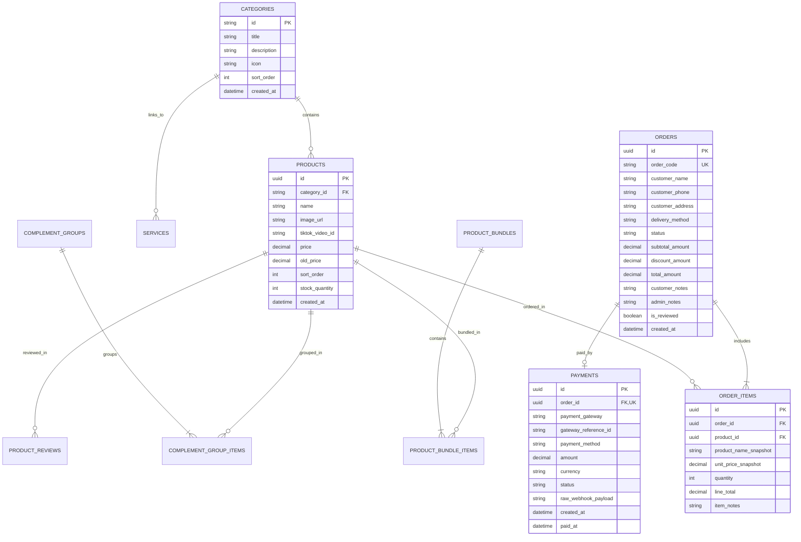
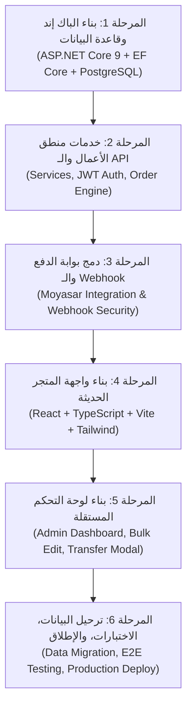

# خطة التحول المعماري الشاملة: من النموذج الأولي إلى نظام Production متكامل
## متجر مكتبة أنوار الواحة (Anwar Al Wahah Store)

---

> **وثيقة معمارية وتنفيذية (Architectural & Migration Plan)**  
> **تاريخ التوثيق:** نوفمبر 2026  
> **الهدف:** تحويل المتجر الحالي القائم على صفحات مستقلة و Babel Standalone و Supabase Client-side إلى نظام متكامل عالي الأداء والجاهزية للإنتاج (Production-Grade) يتكون من:
> 1. **Backend API:** مبني بواسطة **ASP.NET Core 9 Web API** بنمط **3-Layer Architecture** مع **Entity Framework Core 9** و **PostgreSQL**.
> 2. **Frontend:** تطبيق **React 18/19 + TypeScript + Vite** بتصميم عربي RTL متكامل مع **Tailwind CSS** وخط **Cairo**، وبنية معيارية (Modular) حديثة.

---

## فهرس المحتويات
1. [القسم 1: تحليل وتفكيك الوضع الحالي (Current State Analysis)](#القسم-1-تحليل-وتفكيك-الوضع-الحالي-current-state-analysis)
2. [القسم 2: هيكل المجلدات المستهدف (Target Directory Structure)](#القسم-2-هيكل-المجلدات-المستهدف-target-directory-structure)
3. [القسم 3: تصميم قاعدة البيانات وهندسة الـ API والأمان (Database & API Architecture)](#القسم-3-تصميم-قاعدة-البيانات-وهندسة-الـ-api-والأمان-database--api-architecture)
4. [القسم 4: مراحل التنفيذ المتسلسلة ومعايير النجاح (Phased Execution Plan & Acceptance Criteria)](#القسم-4-مراحل-التنفيذ-المتسلسلة-ومعايير-النجاح-phased-execution-plan--acceptance-criteria)

---

## القسم 1: تحليل وتفكيك الوضع الحالي (Current State Analysis)

### 1.1 الجداول الحالية في قاعدة البيانات (Supabase PostgreSQL)
يحتوي المشروع الحالي على 11 جدولاً في الـ Schema العام، مع سياسات RLS (Row Level Security):

| اسم الجدول | الوصف والوظيفة | الحقول الحالية | المفاتيح والعلاقات |
| :--- | :--- | :--- | :--- |
| **`categories`** | تصنيفات وأقسام المتجر (15 قسماً أساسياً) | `id (TEXT)`, `title`, `description`, `icon`, `sort_order`, `created_at` | Primary Key: `id` |
| **`products`** | أصناف ومنتجات المكتبة | `id (UUID)`, `category_id (TEXT)`, `name`, `image_url`, `tiktok_video_id`, `price`, `old_price`, `sort_order`, `created_at` | Foreign Key: `category_id -> categories.id` (ON DELETE CASCADE) |
| **`product_complements`** | ربط يدوي ثنائي بين منتج ومنتج تكميلي | `id (UUID)`, `product_id (UUID)`, `complement_id (UUID)`, `created_at` | Foreign Keys لـ `products.id` |
| **`complement_groups`** | مجموعات المنتجات التكميلية المتبادلة | `id (UUID)`, `title`, `is_active`, `created_at` | Primary Key: `id` |
| **`complement_group_items`** | عناصر المجموعات التكميلية | `id (UUID)`, `group_id (UUID)`, `product_id (UUID)`, `created_at` | Foreign Keys لـ `complement_groups` و `products` |
| **`category_complement_rules`** | قواعد الربط التلقائي بين الأقسام | `id (UUID)`, `source_category_id (TEXT)`, `target_category_id (TEXT)`, `created_at` | Foreign Keys لـ `categories.id` |
| **`product_bundles`** | الباقات والأطقم الحصرية المخصصة | `id (UUID)`, `title`, `bundle_price`, `is_active`, `sort_order`, `created_at` | Primary Key: `id` |
| **`product_bundle_items`** | محتويات الباقات والكميات المحددة | `id (UUID)`, `bundle_id (UUID)`, `product_id (UUID)`, `created_at` | Foreign Keys لـ `product_bundles` و `products` |
| **`orders`** | طلبات الزبائن وتتبع حالتها | `id (UUID)`, `order_code (TEXT UNIQUE)`, `customer_name`, `customer_phone`, `delivery_method`, `status`, `items (JSONB)`, `total_amount`, `customer_notes`, `admin_notes`, `is_reviewed`, `created_at` | Primary Key: `id` |
| **`product_reviews`** | تقييمات العملاء للمنتجات والخدمات | `id (UUID)`, `product_id (UUID)`, `order_code (TEXT)`, `customer_name`, `rating`, `comment`, `media_urls (TEXT[])`, `is_approved`, `created_at` | Foreign Key: `product_id -> products.id` |
| **`services`** | خدمات واستوديوهات المكتبة الـ 6 | `id (UUID)`, `title`, `description`, `icon_name`, `accent_color`, `media_type`, `media_url`, `linked_category_id (TEXT)`, `whatsapp_template`, `sort_order`, `is_active`, `created_at` | Foreign Key: `linked_category_id -> categories.id` |

---

### 1.2 مكونات الواجهة الأمامية الحالية (Frontend Inventory)
الملفات الحالية مقسمة وفق هيكل تدرجي يعمل عبر المتصفح باستخدام `<script type="text/babel">`:

1. **`index.html`**: نقطة الدخول لمتجر العملاء؛ يستدعي React 18 UMD، مكتبة Tailwind عبر CDN، استيراد خط Cairo، ومكتبات Canvas Confetti و Supabase JS.
2. **`admin.html`**: صفحة لوحة التحكم الكاملة؛ تحتوي على نظام المصادقة، الإحصائيات، التعديل السريع الجماعي (Bulk Edit)، إدارة الخدمات، ونافذة النقل المزدوج للمنتجات (Category Transfer Modal).
3. **`js/constants.js`**: الثوابت المركزية؛ رموز الأسعار، التبويبات الـ 15، السلايدرات، مصفوفة مراحل تتبع الطلب الـ 5، ودوال استخراج معرف TikTok وخوارزمية التكميل.
4. **`js/ProductCard.js`**: بطاقة المنتج الصغير في الشبكة؛ حساب نسبة الخصم تلقائياً، إظهار النجوم والتقييم، وزر الإضافة السريعة للسلة مع تأثير Confetti.
5. **`js/ProductModal.js`**: نافذة تفاصيل المنتج؛ محدد الكمية، صور المنتج، مشغل تيك توك، استعراض المنتجات المكملة، باقات التوفير، وقائمة تقييمات المشترين.
6. **`js/CartDrawer.js`**: درج سلة الشراء؛ تعديل الكميات والملاحظات لكل صنف، خيارات الاستلام (استلام من الفرع أو توصيل مع تحديد GPS)، احتساب الإجمالي، وإرسال الطلب (واتساب أو مباشر).
7. **`js/ProfileOrders.js`**: الملف الشخصي وتتبع الطلبات؛ حفظ بيانات العميل محلياً، شريط مراحل التتبع التفاعلي، البحث بكود الطلب، نافذة تقييم المنتجات مع رفع الصور/الفيديو، وقائمة المفضلة.
8. **`js/ServicesView.js`**: شبكة الخدمات الدائرية المميزة؛ النوافذ المنبثقة التفاعلية، مشغل الفيديو وتيك توك v1 الحديث، وروابط الاستفسار عبر واتساب.
9. **`js/App.js`**: المكون الجذري المنسق لكافة الحالات المشتركة، السلة، التنبيهات، والربط اللحظي بـ Supabase.

---

### 1.3 نقاط الضعف والمخاطر في البنية الحالية (Pain Points & Architectural Risks)
1. **غياب Backend حقيقي (Direct Client-to-DB):**
   - المتصفح يتصل مباشرة بـ Supabase باستخدام `Anon Key`. على الرغم من وجود RLS، إلا أن منطق الأعمال (Business Logic) وحساب الأسعار مكشوف في جانب العميل.
2. **ثغرة حساب الأسعار في المتصفح (Client-side Price Calculation):**
   - العميل يرسل `total_amount` ومصفوفة `items` من المتصفح مباشرة إلى جدول `orders`. هذا يمثل مخاطرة مالية حرجة (تسمح بتعديل السعر عبر أدوات المطورين قبل الإرسال).
3. **غياب بوابة دفع إلكتروني موثقة من السيرفر (Server-Side Webhook):**
   - لا يمكن تفعيل بوابات الدفع الرسمية (مثل Moyasar أو Tap) بدون سيرفر خلفي آمن يستقبل Webhook مشفراً للتحقق من التوقيع الرقمي وتأكيد سداد الفاتورة قبل تحديث حالة الطلب.
4. **تخزين عناصر الطلب في عمود `JSONB` غير مهيكل:**
   - جدول `orders` يخزن الأصناف كـ JSON داخل عمود واحد، مما يصعب عمليات التقارير المحاسبية، الجرد، تتبع الأصناف الأكثر مبيعاً، والربط العلائقي مع المنتجات.
5. **بطء الإقلاع وحجم الحزم (Babel Standalone Performance):**
   - قيام المتصفح بتحويل أكواد JSX إلى JavaScript لحظياً أثناء تحميل الصفحة عبر `babel.min.js` يستهلك معالج جهاز العميل ويؤخر ظهور المحتوى، ويمنع الاستفادة من ميزات TypeScript الصارمة والـ Tree Shaking.

---

## القسم 2: هيكل المجلدات المستهدف (Target Directory Structure)

سيتم تنظيم النظام المستهدف في مستودع موحد (Monorepo) أو مستودعين منفصلين يحتويان على مشروع الباك إند ومشروع الفرونت إند:

```text
maktabah-platform/
│
├── backend/
│   └── AnwarAlwaha.API/                  # مشروع ASP.NET Core 9 Web API
│       ├── AnwarAlwaha.API.csproj
│       ├── Program.cs                    # نقطة الدخول، إعداد DI، الـ Middlewares، وقواعد الأمان
│       ├── appsettings.json              # إعدادات النظام وقنوات الاتصال
│       ├── appsettings.Development.json
│       │
│       ├── Controllers/                  # [Layer 1] طبقة الـ Controllers (API Endpoints)
│       │   ├── BaseApiController.cs      # وحدة تحكم أساسية موحدة للاستجابات (API Response Envelope)
│       │   ├── AuthController.cs         # مصادقة المشرفين وتوليد رموز JWT
│       │   ├── CategoriesController.cs   # تصفح الأقسام للعامة
│       │   ├── ProductsController.cs     # المنتجات، البحث، الفلاتر، والتكميليات
│       │   ├── ServicesController.cs     # خدمات المكتبة والاستوديوهات
│       │   ├── BundlesController.cs      # باقات التوفير والأطقم
│       │   ├── OrdersController.cs       # إنشاء وتتبع الطلبات (حساب الأسعار بالسيرفر)
│       │   ├── ReviewsController.cs      # تقييمات العملاء
│       │   ├── PaymentsController.cs     # بدء الدفع ومعالجة Moyasar Webhook
│       │   └── Admin/                    # مسارات لوحة التحكم المحمية [Authorize(Roles = "Admin")]
│       │       ├── AdminDashboardController.cs
│       │       ├── AdminCategoriesController.cs
│       │       ├── AdminProductsController.cs    # يتضمن التعديل السريع الجماعي Bulk
│       │       ├── AdminServicesController.cs
│       │       ├── AdminBundlesController.cs
│       │       ├── AdminComplementsController.cs
│       │       ├── AdminOrdersController.cs
│       │       └── AdminReviewsController.cs
│       │
│       ├── Services/                     # [Layer 2] طبقة منطق الأعمال والعمليات (Business Logic Layer)
│       │   ├── Interfaces/
│       │   │   ├── IAuthService.cs
│       │   │   ├── IProductService.cs
│       │   │   ├── ICategoryService.cs
│       │   │   ├── IOrderService.cs
│       │   │   ├── IPaymentService.cs
│       │   │   ├── IMoyasarPaymentService.cs
│       │   │   └── IFileStorageService.cs
│       │   └── Implementations/
│       │       ├── AuthService.cs
│       │       ├── ProductService.cs
│       │       ├── CategoryService.cs
│       │       ├── OrderService.cs       # احتساب الأسعار الموثقة، الفواتير، وفحص المخزون
│       │       ├── PaymentService.cs
│       │       ├── MoyasarPaymentService.cs # التحقق من توقيع الـ Webhook ومعالجة الحالات
│       │       └── LocalFileStorageService.cs
│       │
│       ├── Repositories/                 # [Layer 3] طبقة الوصول للبيانات (Data Access Layer)
│       │   ├── Interfaces/
│       │   │   ├── IGenericRepository.cs
│       │   │   ├── IProductRepository.cs
│       │   │   ├── ICategoryRepository.cs
│       │   │   ├── IOrderRepository.cs
│       │   │   ├── IReviewRepository.cs
│       │   │   └── IUnitOfWork.cs        # إدارة المعاملات المالية (Transactions)
│       │   └── Implementations/
│       │       ├── GenericRepository.cs
│       │       ├── ProductRepository.cs
│       │       ├── CategoryRepository.cs
│       │       ├── OrderRepository.cs
│       │       ├── ReviewRepository.cs
│       │       └── UnitOfWork.cs
│       │
│       ├── Data/                         # سياق قاعدة البيانات والتهيئة
│       │   ├── AppDbContext.cs           # Entity Framework Core 9 DbContext
│       │   ├── Configurations/           # Fluent API Entity Configurations
│       │   │   ├── CategoryConfiguration.cs
│       │   │   ├── ProductConfiguration.cs
│       │   │   ├── OrderConfiguration.cs
│       │   │   ├── OrderItemConfiguration.cs
│       │   │   ├── PaymentConfiguration.cs
│       │   │   └── BundleConfiguration.cs
│       │   ├── Migrations/               # سجل هجرات EF Core
│       │   └── Seed/                     # بيانات البداية (15 قسماً، الخدمات، والمنتجات)
│       │       └── DbInitializer.cs
│       │
│       ├── Entities/                     # نماذج الجداول (Domain Entities)
│       │   ├── BaseEntity.cs
│       │   ├── Category.cs
│       │   ├── Product.cs
│       │   ├── ProductComplement.cs
│       │   ├── ComplementGroup.cs
│       │   ├── ComplementGroupItem.cs
│       │   ├── CategoryComplementRule.cs
│       │   ├── ProductBundle.cs
│       │   ├── ProductBundleItem.cs
│       │   ├── ServiceItem.cs
│       │   ├── Order.cs
│       │   ├── OrderItem.cs              # جدول وسيط مهيكل للأصناف
│       │   ├── PaymentTransaction.cs     # جدول سجلات الدفع الإلكتروني
│       │   ├── ProductReview.cs
│       │   └── AdminUser.cs              # حسابات الإدارة والمصادقة
│       │
│       ├── DTOs/                         # كائنات نقل البيانات (Requests & Responses)
│       │   ├── Auth/                     # LoginRequest, AuthResponse, TokenRefreshDto
│       │   ├── Products/                 # ProductDto, ProductCreateDto, BulkProductUpdateDto
│       │   ├── Categories/               # CategoryDto, CategoryTransferRequestDto
│       │   ├── Orders/                   # CreateOrderDto, OrderResponseDto, OrderStatusUpdateDto
│       │   ├── Payments/                 # InitiatePaymentDto, MoyasarWebhookPayloadDto
│       │   └── Common/                   # PagedResultDto<T>, ApiResponse<T>
│       │
│       ├── Middlewares/                  # البرمجيات الوسيطة للأمان والتحكم
│       │   ├── GlobalExceptionMiddleware.cs # معالجة الأخطاء وإرجاع RFC 7807 ProblemDetails
│       │   ├── SecurityHeadersMiddleware.cs # HSTS, X-Content-Type-Options, Frame-Options
│       │   └── RateLimitingMiddleware.cs
│       │
│       └── Common/                       # الثوابت، المساعدات، والمحددات
│           ├── Constants/
│           │   ├── OrderStatuses.cs
│           │   └── PaymentStatuses.cs
│           └── Exceptions/
│               ├── NotFoundException.cs
│               ├── ValidationException.cs
│               └── PaymentException.cs
│
└── frontend/
    └── anwar-alwaha-web/                 # مشروع React + TypeScript + Vite
        ├── package.json
        ├── tsconfig.json
        ├── vite.config.ts
        ├── tailwind.config.js            # ثيم المتجر وألوان هوية أنوار الواحة
        ├── index.html
        │
        └── src/
            ├── main.tsx                  # إعداد React Router والـ Providers المركزية
            ├── App.tsx                   # تخطيط الهيكل والروابط العامة
            ├── index.css                 # خط Cairo وتنسيقات RTL الأساسية
            │
            ├── api/                      # طبقة الاتصال بالسيرفر
            │   ├── client.ts             # إعداد Axios مع BaseURL والـ Interceptors لرموز JWT
            │   ├── productsApi.ts
            │   ├── categoriesApi.ts
            │   ├── ordersApi.ts
            │   ├── paymentsApi.ts
            │   ├── servicesApi.ts
            │   └── adminApi.ts
            │
            ├── types/                    # واجهات TypeScript المطابقة تماماً لـ DTOs الباك إند
            │   ├── product.types.ts
            │   ├── category.types.ts
            │   ├── order.types.ts
            │   ├── payment.types.ts
            │   ├── review.types.ts
            │   └── api.types.ts
            │
            ├── context/                  # سياقات إدارة الحالة المشتركة
            │   ├── CartContext.tsx       # إدارة السلة، الكميات، وحساب الإجماليات المؤقتة
            │   ├── AuthContext.tsx       # مصادقة المدير، حفظ التوكن وتجديده
            │   └── ToastContext.tsx      # نظام التنبيهات والإشعارات العائمة
            │
            ├── hooks/                    # خطافات مخصصة (Custom Hooks)
            │   ├── useCart.ts
            │   ├── useDebounce.ts
            │   ├── useOrders.ts
            │   └── useGpsLocation.ts
            │
            ├── components/               # مكونات واجهة المستخدم العامة المشتركة
            │   ├── common/
            │   │   ├── Header.tsx        # ترويسة المتجر مع أيقونة المحل وشريط البحث
            │   │   ├── BottomNav.tsx     # شريط التنقل السفلي للهواتف
            │   │   ├── Footer.tsx        # تذييل المتجر الرسمي
            │   │   ├── Modal.tsx         # نافذة منبثقة عامة مع قفل التمرير
            │   │   ├── PriceTag.tsx      # وسم عرض السعر والخصم مع عملة ر.س
            │   │   ├── StarRating.tsx
            │   │   └── ToastContainer.tsx
            │   ├── cart/
            │   │   ├── CartDrawer.tsx    # درج السلة المتقدم
            │   │   ├── CartItemRow.tsx
            │   │   └── DeliveryOptions.tsx
            │   └── products/
            │       ├── ProductCard.tsx
            │       ├── ProductModal.tsx
            │       └── ComplementaryList.tsx
            │
            ├── pages/                    # صفحات المتجر الرئيسية
            │   ├── HomePage.tsx          # الواجهة الرئيسية، السلايدر، والأقسام السريعة
            │   ├── CategoriesPage.tsx    # استعراض شجرة التصنيفات والمنتجات
            │   ├── ServicesPage.tsx      # قسم الخدمات واستوديوهات الطباعة
            │   ├── CheckoutPage.tsx      # صفحة الدفع الإلكتروني المدمجة (Moyasar Form)
            │   ├── OrderTrackingPage.tsx # تتبع مراحل الطلب بكود الشحنة والتقييم
            │   └── NotFoundPage.tsx
            │
            └── admin/                    # مجلد لوحة التحكم المستقل والمحمي
                ├── AdminLayout.tsx       # القائمة الجانبية والشريط العلوي للمشرف
                ├── LoginPage.tsx         # تسجيل دخول المشرفين
                ├── pages/
                │   ├── DashboardOverview.tsx # مؤشرات المبيعات، الإيرادات، وأحدث الطلبات
                │   ├── OrdersManager.tsx     # تحديث حالات الطلبات وطباعة الفواتير
                │   ├── ProductsManager.tsx   # إدارة الأصناف والتعديل السريع الجماعي
                │   ├── CategoriesManager.tsx # إدارة الأقسام مع نافذة النقل المزدوج
                │   ├── ServicesManager.tsx   # إدارة الخدمات وأفلام التيك توك
                │   ├── ComplementsManager.tsx# قواعد التكميل الذكي
                │   └── ReviewsModerator.tsx  # اعتماد تقييمات الزبائن
                └── components/
                    ├── CategoryTransferModal.tsx # نافذة النقل المزدوج بنمط Split-View
                    └── BulkEditToolbar.tsx
```

---

## القسم 3: تصميم قاعدة البيانات وهندسة الـ API والأمان (Database & API Architecture)

### 3.1 تصميم مخطط قاعدة البيانات العلائقية (Relational Database Schema)

في بنية الإنتاج، سيتم تحويل الجداول غير المهيكلة إلى علاقات نظامية تدعم تكامل البيانات (Data Integrity):



---

### 3.2 هندسة ومسارات الـ Endpoints (RESTful API Specifications)

#### أ. مسارات المتجر العامة (Public Storefront API)

| الدالة | المسار (Route) | الأمان (Auth) | الوظيفة وقواعد العمل |
| :--- | :--- | :--- | :--- |
| `GET` | `/api/categories` | Public | جلب كافة الأقسام النشطة مرتبة حسب `sort_order` مع عداد المنتجات في كل قسم. |
| `GET` | `/api/products` | Public | جلب المنتجات مع دعم Pagination و البحث بالاسم والفلترة بالقسم وترتيب الأسعار. |
| `GET` | `/api/products/{id}` | Public | تفاصيل المنتج متضمنة الأصناف التكميلية المرتبطة به والباقات الحصرية التي يشترك فيها. |
| `GET` | `/api/services` | Public | جلب الخدمات الـ 6 واستوديوهات الطباعة والوسائط وروابط تيك توك. |
| `GET` | `/api/bundles` | Public | استعراض باقات التوفير الفعالة مع قائمة منتجات كل باقة وحساب قيمة التوفير. |
| `POST` | `/api/orders` | Public | **إنشاء طلب جديد مع التدقيق السعري الصارم بالسيرفر:** يستقبل قائمة معرفات الأصناف والكميات فقط؛ يقوم السيرفر بجلب أسعار المنتجات الحالية من قاعدة البيانات، حساب الخصومات و`old_price`، توليد `order_code` فريد، وإنشاء عناصر `order_items` وحساب `total_amount` دون الوثوق بأي سعر ممرر من العميل. |
| `GET` | `/api/orders/{orderCode}` | Public | استعلام العميل عن حالة طلبه، بنود الفاتورة، ومرحلة التتبع الحالية. |
| `POST` | `/api/reviews` | Public | تقديم تقييم لمنتج بعد التحقق من وجود كود طلب صالح، وتكون حالة المراجعة `Pending` حتى يعتمدها المشرف. |

---

#### ب. مسارات الدفع الإلكتروني وبوابة Moyasar (Payments & Webhook)

| الدالة | المسار (Route) | الأمان (Auth) | الوظيفة وقواعد العمل |
| :--- | :--- | :--- | :--- |
| `POST` | `/api/payments/initiate` | Public | بدء عملية دفع إلكتروني لطلب محدد؛ يقوم السيرفر بإنشاء سجل دفع بالحالة `Initiated`، وإرجاع بيانات الجلسة لنموذج Moyasar Form المدمج بالواجهة. |
| `POST` | `/api/payments/webhook` | **Webhook Signature Header** | **نقطة استقبال إشعارات بوابة ميسر المشفرة:** <br>1. فحص توقيع الطلب (`Moyasar-Signature`) باستخدام المفتاح السري المشترك (Webhook Secret) المعتمد عبر خوارزمية HMAC-SHA256.<br>2. عند التحقق وصحة الدفع (`status == "paid"`)، يتم داخل Database Transaction تحديث حالة الدفع إلى `Paid`، تحديث حالة الطلب إلى `Processing`، خصم الكميات من المخزون، وتسجيل مرجع العملية البنكية (`gateway_reference_id`).<br>3. يتم إرجاع HTTP `200 OK` فوراً لمنع البوابة من إعادة المحاولة. |
| `GET` | `/api/payments/verify/{orderId}` | Public | استعلام الواجهة الأمامية عن حالة السداد فور اكتمال عملية الدفع في المتصفح. |

---

#### ج. مسارات لوحة التحكم الإدارية (`/api/admin/*`)
جميع هذه المسارات محمية برمجياً عبر السيرفر وتتطلب توكن JWT صالح مع دور المشرف `[Authorize(Roles = "Admin")]`:

| الدالة | المسار (Route) | الوظيفة وقواعد العمل |
| :--- | :--- | :--- |
| `POST` | `/api/admin/auth/login` | تسجيل دخول المشرف، التحقق من كلمة المرور المشفرة (BCrypt/Argon2)، وتوليد Access Token مع Refresh Token آمن (HttpOnly Cookie). |
| `GET` | `/api/admin/dashboard/stats` | جلب إحصائيات لوحة التحكم: إجمالي مبيعات اليوم والشهر، عدد الطلبات المعلقة، والمنتجات منخفضة المخزون. |
| `GET` | `/api/admin/orders` | استعراض كافة الطلبات مع فلاتر الحالة وتاريخ الإنشاء وطريقة الاستلام. |
| `PATCH` | `/api/admin/orders/{id}/status` | تحديث مرحلة الطلب وإضافة ملاحظات الإدارة (`admin_notes`). |
| `PATCH` | `/api/admin/products/bulk` | **التعديل السريع الجماعي للأصناف (Bulk Edit):** يستقبل مصفوفة كائنات تحتوي على `id` والحقول المطلوب تعديلها دفعة واحدة (تعديل أسعار جماعي، نسب خصم، إزالة خصومات، أو تعديل أسماء)، وتُنفذ كمعاملة ذرية واحدة (Atomic Transaction). |
| `POST` | `/api/admin/categories/transfer-products` | **نقل الأصناف بين الأقسام (Category Transfer):** يستقبل `sourceCategoryId`, `targetCategoryId`, وقائمة `productIds` لتنفيذ النقل الجماعي وتحديث عدادات الأقسام فوراً. |
| `POST` | `/api/admin/products` | إضافة منتج جديد مع دعم رفع الصور للسيرفر المحلي أو Cloud Storage. |
| `PUT` | `/api/admin/products/{id}` | تعديل بيانات الصنف بالكامل. |
| `DELETE`| `/api/admin/products/{id}` | حذف منتج محدد مع التحقق من عدم وجوده في طلبات سابقة معلقة. |
| `POST` | `/api/admin/categories` | إضافة قسم جديد وتحديد الترتيب والأيقونة. |
| `PUT` | `/api/admin/categories/{id}` | تعديل بيانات القسم وتغيير ترتيبه. |
| `DELETE`| `/api/admin/categories/{id}` | حذف القسم بعد حماية الأصناف التابعة له أو إعادة توجيهها. |
| `PATCH` | `/api/admin/reviews/{id}/approve` | اعتماد تقييم ليظهر لعامة الزوار على المتجر. |

---

### 3.3 قواعد الأمان والبنية التحتية (Security Architecture)

1. **حساب الأسعار الموثق (Server-Side Pricing Authority):**
   - السيرفر هو المصدر الوحيد للحقيقة فيما يخص الأسعار. أي مصفوفة سلة مرسلة من واجهة المستخدم تحتوي فقط على `{ productId, quantity, notes }`. يقوم الـ `OrderService` بالاستعلام المباشر عن السعر الحقيقي وقيمة الخصم من قاعدة البيانات، واحتساب الإجمالي، مما يلغي تماماً أي إمكانية للتلاعب عبر تزوير الطلبات في المتصفح.

2. **حماية مسارات لوحة التحكم (JWT Authentication & RBAC):**
   - إصدار توكنات JWT مشفرة باستخدام مفتاح بطول 512-bit وخوارزمية `HmacSha512`.
   - صلاحية التوكن الأساسي (Access Token) تكون قصيرة (15 إلى 30 دقيقة)، مع استخدام `Refresh Token` مشفر ومخزن في قاعدة البيانات داخل `HttpOnly` Secure Cookie لمنع هجمات XSS.

3. **حماية بوابة الدفع والـ Webhooks:**
   - نقطة نهاية `/api/payments/webhook` لا تعتمد على مصادقة المستخدم، بل تفحص هيدر التوقيع الرقمي الصادر حصرياً من خوادم Moyasar.
   - التحقق من تفرد معرف العملية (`Idempotency Key`) لضمان عدم تنفيذ نفس العملية أكثر من مرة في حال تكرار إشعار الـ Webhook.

4. **البرمجيات الوسيطة للأمان والتحكم:**
   - **CORS Policy:** قصر السماح بالاتصال على نطاق المتجر المعتمد (مثل `https://anwaralwaha.com` ونطاق التطوير المحلي)، مع حظر الـ Wildcards `*` عند استخدام أوراق الاعتماد (Credentials).
   - **Rate Limiting:** تطبيق محدد معدل الطلبات باستخدام خوارزمية Token Bucket في ASP.NET Core 9 (مثلاً: 10 طلبات في الدقيقة لمسارات تسجيل الدخول ومسار إنشاء الطلبات لمنع هجمات الـ Brute-force و DDoS).
   - **Input Validation:** فحص كافة المدخلات باستخدام مكتبة **FluentValidation** الصارمة لضمان صحة أرقام الهواتف السعودية (`^05\d{8}$`) ونصوص الحقول ومنع ثغرات الـ SQL Injection والـ XSS.
   - **Global Exception Handling:** برمجية وسيطة مركزية تلتقط أي خطأ غير معالج، تسجله في الـ Logs، وتعيد للعميل استجابة موحدة بصيغة RFC 7807 (`ProblemDetails`) برمز خطأ عام دون كشف تفاصيل البنية التحتية أو السيرفر.

---

## القسم 4: مراحل التنفيذ المتسلسلة ومعايير النجاح (Phased Execution Plan & Acceptance Criteria)

تم تقسيم خطة التحول إلى 6 مراحل متسلسلة؛ حيث تعتمد كل مرحلة على جاهزية سابقتها:



---

### المرحلة 1: إعداد مشروع الباك إند والبنية التحتية لقاعدة البيانات
* **المهام التنفيذية:**
  1. إنشاء مشروع `AnwarAlwaha.API` باستخدام .NET 9 بنمط Clean 3-Layer Structure.
  2. تثبيت الحزم الأساسية: `Npgsql.EntityFrameworkCore.PostgreSQL`، `Microsoft.AspNetCore.Authentication.JwtBearer`، `FluentValidation.AspNetCore`.
  3. كتابة كيانات الـ Domain Entities بالكامل مع الـ Fluent API Configurations.
  4. إنشاء الـ `AppDbContext` وإنشاء التهجير الأولي (Initial Migration).
  5. إنشاء سكريبت بذر البيانات (DbInitializer) لتهيئة الأقسام والخدمات وحساب المسؤول الافتراضي.
* **معيار النجاح (Acceptance Criteria):**
  - بناء المشروع بنجاح دون أي تحذيرات أو أخطاء (`dotnet build -> 0 errors`).
  - تشغيل هجرة قاعدة البيانات وإنشاء جميع الجداول الـ 11 بنجاح على سيرفر PostgreSQL محلي مع بذر البيانات الأولية.

---

### المرحلة 2: بناء خدمات منطق الأعمال ومسارات الـ API والمصادقة
* **المهام التنفيذية:**
  1. تطبيق نمط المستودعات ووحدة العمل (`GenericRepository` و `UnitOfWork`).
  2. برمجة `AuthService` لتوثيق المشرفين وإصدار توكنات JWT وتحديثها.
  3. برمجة `ProductService` و `CategoryService` ومسارات التصفح العامة والبحث.
  4. برمجة `OrderService` ومسار `POST /api/orders` مع التدقيق السعري الصارم بالسيرفر.
  5. تفعيل البرمجيات الوسيطة: معالج الأخطاء المركزي `GlobalExceptionMiddleware`، فاحص المدخلات `FluentValidation`، وإعدادات CORS.
* **معيار النجاح (Acceptance Criteria):**
  - فحص جميع مسارات الـ Public و الـ Admin بنجاح عبر Swagger UI أو Postman.
  - إرسال طلب جديد مع أسعار غير حقيقية والتحقق من أن السيرفر يتجاهلها ويحسب السعر الفعلي من قاعدة البيانات بدقة تامة.

---

### المرحلة 3: دمج بوابة الدفع الإلكتروني Moyasar وتأمين الـ Webhook
* **المهام التنفيذية:**
  1. برمجة `MoyasarPaymentService` لتهيئة جلسات الدفع الإلكتروني (مدى، Apple Pay، والبطاقات).
  2. برمجة مسار الاستقبال المباشر `POST /api/payments/webhook`.
  3. تطبيق خوارزمية التحقق من توقيع HMAC-SHA256 لمطابقة الهيدر المرسل من Moyasar.
  4. إدارة المعاملات المصرفية (Database Transaction): تحويل الطلب إلى `Processing` وتسجيل بيانات الدفع عند نجاح العملية، أو تسجيل الفشل إذا أُلغيت.
* **معيار النجاح (Acceptance Criteria):**
  - محاكاة إرسال Webhook بتوقيع مزور والتأكد من رفض السيرفر للطلب برمز `401 Unauthorized`.
  - محاكاة إرسال Webhook رسمي معتمد بالوضع التجريبي (Test Mode) والتأكد من تحديث حالة الطلب إلى `Paid` في قاعدة البيانات خلال أقل من 500ms.

---

### المرحلة 4: بناء الواجهة الأمامية للمتجر (React + TypeScript + Vite)
* **المهام التنفيذية:**
  1. إنشاء مشروع `anwar-alwaha-web` باستخدام Vite و React 18/19 و TypeScript.
  2. إعداد Tailwind CSS بالهوية البصرية الرسمية لمكتبة أنوار الواحة وخط Cairo العربي.
  3. إنشاء طبقة الاتصال البرمجية `src/api` باستخدام Axios مع تعريف كافة الأنواع `types/`.
  4. بناء المكونات الأساسية: الترويسة، درج السلة `CartDrawer`، بطاقات المنتجات `ProductCard`، ونوافذ التفاصيل `ProductModal`.
  5. ربط واجهة الدفع المدمجة (Moyasar Form) في صفحة إتمام الطلب لتشغيل بطاقات مدى و Apple Pay.
* **معيار النجاح (Acceptance Criteria):**
  - بناء المشروع بالكامل عبر `npm run build` بنجاح وإنتاج ملفات Static نقية خالية من أخطاء TypeScript (0 type errors).
  - تجربة تجربة مستخدم كاملة: تصفح صنف، إضافته للسلة، واختيار الدفع لإنشاء طلب حقيقي بنجاح.

---

### المرحلة 5: تطوير لوحة تحكم المشرف (Admin Dashboard & Bulk Actions)
* **المهام التنفيذية:**
  1. بناء واجهة تسجيل الدخول وحماية مسارات المشرف عبر `AdminLayout` و `AuthContext`.
  2. بناء صفحات إدارة الأصناف مع شريط التعديل السريع الجماعي (Bulk Edit Toolbar) لتعديل الأسعار والخصومات بنقرة واحدة.
  3. بناء نافذة النقل المزدوج بنمط Split View (`CategoryTransferModal`) لتمكين نقل الأصناف بين الأقسام وسحب التغييرات دفعة واحدة.
  4. بناء صفحات متابعة الطلبات، إدارة الخدمات، واعتماد التقييمات.
* **معيار النجاح (Acceptance Criteria):**
  - تجربة تعديل أسعار 20 منتجاً دفعة واحدة والتأكد من تنفيذ السيرفر للطلب في عملية واحدة واستجابة الواجهة فوراً.
  - تجربة نقل أصناف بين قسمين والتأكد من تحديث عداد الأقسام في قاعدة البيانات والواجهة بدقة.

---

### المرحلة 6: ترحيل البيانات الحالية، الاختبارات الشاملة، والتشغيل النهائي
* **المهام التنفيذية:**
  1. كتابة سكريبت ترحيل آلي لنقل كافة البيانات الحالية من Supabase إلى قاعدة بيانات PostgreSQL الجديدة (الأقسام، المنتجات الـ 100+، تقييمات العملاء، وصور المنتجات).
  2. إجراء اختبارات الحمل والأمان (Load Testing & Security Audit) على مسارات الـ API.
  3. ربط الدومين المخصص وإعداد شهادات الأمان SSL/TLS التلقائية.
  4. تجهيز ملفات النشر للباك إند (Docker Container أو Linux/IIS Server) والفرونت إند (Cloudflare Pages أو Nginx).
* **معيار النجاح (Acceptance Criteria):**
  - اكتمال ترحيل 100% من المنتجات والأقسام الحالية دون أي فقدان للبيانات.
  - جاهزية متجر Production متكامل يستقبل الزوار والدفع الإلكتروني المباشر ويعمل بكفاءة فائقة.

---

> ⚠️ **تنبيه:** تم إعداد هذه الوثيقة كخطة تخطيطية فقط، ولن يتم الشروع في تنفيذ أي مرحلة حتى تتم مراجعتها واعتمادها بالكامل.
