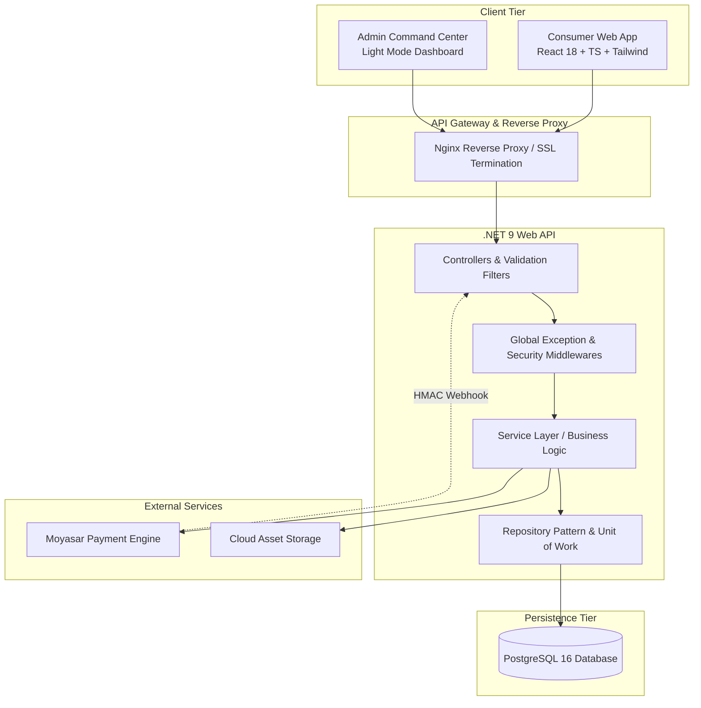

# 📚 Anwar Al-Waha Enterprise E-Commerce & Printing Platform

[](https://dotnet.microsoft.com/)
[](https://react.dev/)
[](https://www.postgresql.org/)
[-38B2AC?style=for-the-badge&logo=tailwind-css)](https://tailwindcss.com/)
[](https://moyasar.com/)
[](https://www.docker.com/)

> **Production-grade, omnichannel e-commerce ecosystem and digital printing dispatch platform built for *Anwar Al-Waha Library*. Engineered with modern clean architecture, secure electronic payments, high-performance catalog indexing, and enterprise administrative controls.**

---

## 📑 Table of Contents
- [Executive Overview](#-executive-overview)
- [System Architecture & Design Patterns](#-system-architecture--design-patterns)
- [Comprehensive Tech Stack](#-comprehensive-tech-stack)
- [Core Engineering & Business Capabilities](#-core-engineering--business-capabilities)
  - [1. Resilient Payment Pipeline (Moyasar Gateway & Webhooks)](#1-resilient-payment-pipeline-moyasar-gateway--webhooks)
  - [2. Intelligent Search Engine & Live Autocomplete](#2-intelligent-search-engine--live-autocomplete)
  - [3. Verified Customer Experience & Social Proof Engine](#3-verified-customer-experience--social-proof-engine)
  - [4. Enterprise Admin Command Center](#4-enterprise-admin-command-center)
- [Project Directory Structure](#-project-directory-structure)
- [Quick Start & Local Deployment](#-quick-start--local-deployment)
  - [Prerequisites](#prerequisites)
  - [Option A: Docker Compose (Recommended)](#option-a-docker-compose-recommended)
  - [Option B: Manual Bare-Metal Development](#option-b-manual-bare-metal-development)
- [Security, Reliability & Performance Highlights](#-security-reliability--performance-highlights)
- [License & Authorship](#-license--authorship)

---

## 🎯 Executive Overview

**Anwar Al-Waha** is a retail enterprise operating an extensive brick-and-mortar stationery and digital printing center. This project transitions their physical retail footprint into an omnichannel digital platform capable of:
1. Handling thousands of retail stationery SKUs synchronized with legacy POS systems.
2. Managing specialized on-demand printing service inquiries with instant file uploads, custom specifications (paper size, binding, color), and real-time cost estimations.
3. Delivering a frictionless consumer storefront with 100% native Arabic RTL support, mobile-first design, standalone checkout workflows, and secure localized checkout via Saudi payment rails (Mada, Apple Pay, Visa/Mastercard).

---

## 🏛 System Architecture & Design Patterns

The platform adopts a decoupled **Client-Server Architecture** adhering to **Domain-Driven Design (DDD)** and **Clean Architecture** principles.



### Architectural Tenets:
- **Separation of Concerns:** Business rules are isolated from HTTP transport and infrastructure concerns.
- **Repository & Unit of Work Patterns:** Decouples the domain model from data access technologies and coordinates atomic transactional state mutations.
- **Robust Entity Configurations:** Strict database constraints defined using EF Core Fluent API with indexed composite keys, custom enum-string converters, and cascade-delete rules.
- **Fail-Safe Startup Migrations:** Idempotent database migrations executed automatically upon container initialization.

---

## 💻 Comprehensive Tech Stack

| Domain | Technology / Library | Role & Justification |
| :--- | :--- | :--- |
| **Backend Framework** | **ASP.NET Core 9 Web API** | High-throughput, cross-platform enterprise runtime with minimal memory footprint. |
| **ORM & Data Access** | **Entity Framework Core 9 / Npgsql** | Strongly-typed object-relational mapping with PostgreSQL JSON and array support. |
| **Database** | **PostgreSQL 16** | Relational ACID-compliant transactional store with support for full-text search indexing. |
| **Authentication & RBAC** | **JWT (JSON Web Tokens) & BCrypt** | Stateless cryptographic auth with HMAC-SHA256 signature verification and role-based policies. |
| **Frontend Framework** | **React 18 (Vite Bundler)** | Fast HMR, concurrent rendering, and sub-second asset compilation. |
| **Language** | **TypeScript 5.x** | End-to-end type safety eliminating runtime regressions across clients and API DTO contracts. |
| **Styling & Design System** | **Tailwind CSS + Lucide Icons** | Custom high-contrast utility classes with first-class RTL directionality and Cairo Arabic typography. |
| **State Management** | **React Context + Custom Hooks** | Predictable decentralized state modules (`CartContext`, `CustomerContext`, `AuthContext`, `ToastContext`). |
| **Containerization** | **Docker & Multi-Stage Dockerfile** | Consistent build artifacts, isolated runtimes, and predictable deployments. |

---

## 🚀 Core Engineering & Business Capabilities

### 1. Resilient Payment Pipeline (Moyasar Gateway & Webhooks)
- **Omnichannel Checkout:** Native integration supporting **Mada**, **Apple Pay**, **Credit Cards**, and **Cash on Delivery (COD)**.
- **Tamper-Resistant Webhook Engine:** Secure HTTP endpoint validating Moyasar event payloads.
- **Non-Blocking Inventory Reservation:** Custom stock decrement algorithms that honor cashier imported items with zero-initial stock while preventing stock discrepancies.
- **Two-Phase Verification:** Client-side callback redirection paired with asynchronous server-side payment status reconciliation.

### 2. Intelligent Search Engine & Live Autocomplete
- **Dual-Layer Indexing:** Database-backed token matching leveraging both primary product titles and administrative `SearchKeywords` synonym fields.
- **Arabic Text Normalization:** Custom phonetic and diacritic normalizers (`ArabicNormalizer.cs`) mapping variants (e.g., `أ / إ / آ / ا` and `ة / ه`) to maximize query recall.
- **Live Autocomplete Overlay:** Debounced (250ms) search drawer providing instant query suggestions alongside matched product previews (thumbnails, category tags, and instant cart dispatch).

### 3. Verified Customer Experience & Social Proof Engine
- **Frictionless Phone Verification:** Customers track order history and dispatch statuses via Saudi phone normalization (`+9665...`, `05...`) without requiring tedious password setup.
- **Dedicated Cart Experience (`/cart`):** Standalone, distraction-free shopping bag featuring order notes, quantity counters, coupon application, and branch pickup / delivery toggles.
- **Verified Buyer Reviews (`/review/:productId`):** High-integrity review submission portal gated strictly to customers who have an existing confirmed order containing that specific SKU.
- **Interactive Review UI:** Dynamic Arabic star ratings (1-5), one-tap praise chips (*"جودة ممتازة"*, *"تغليف محكم"*, *"توصيل سريع"*), and clean read-only review cards on product detail modals.

### 4. Enterprise Admin Command Center
- **High-Contrast Light Mode UI:** Clean `#F8FAFC` visual environment designed for operational clarity, speed, and ergonomics.
- **Product Bundling & Complementary Engine:** Define upsell rules linking parent categories (e.g., Notebooks) with complementary add-ons (e.g., Pens, Highlighters).
- **Media & Barcode Enrichment:**
  - Automated barcode image resolution via web asset fetchers.
  - Quick image URL editor directly from table views with fallback placeholders.
  - Three-state image filtering (`All`, `Without Image`, `With Image`) for rapid catalog completion.
- **POS Catalog Importer:** Batch CSV import parser with automatic schema mapping, duplicate SKU handling, and stock synchronization.

---

## 📂 Project Directory Structure

```text
c:/por/maktabah/
├── backend/
│   └── AnwarAlwaha.API/
│       ├── Common/                  # Arabic normalizers, phone formatters, settings
│       ├── Controllers/             # API Endpoints (Admin, Orders, Payments, Products, Reviews)
│       ├── Data/                    # AppDbContext, Entity Configurations, Migrations, Seed
│       ├── DTOs/                    # Request/Response Data Transfer Objects
│       ├── Entities/                # Relational Domain Models (Product, Order, Payment, Category)
│       ├── Middlewares/             # Global exception handler & Security headers
│       ├── Repositories/            # Generic Repository & Unit of Work implementations
│       ├── Services/                # Core Business Logic (Moyasar, Orders, Search, POS)
│       ├── Validators/              # Fluent DTO validation schemas
│       ├── appsettings.json         # Production configuration template
│       └── Dockerfile               # Multi-stage .NET 9 release build
│
├── frontend/
│   └── anwar-alwaha-web/
│       ├── public/                  # Static assets & SVG icons
│       ├── src/
│       │   ├── admin/               # Admin layout, sidebar, and dashboard views
│       │   ├── api/                 # Axios clients and typed API service adapters
│       │   ├── components/          # Reusable UI components (Cart, Modal, Cards, Embedders)
│       │   ├── context/             # React Context providers (Auth, Cart, Customer, Toast)
│       │   ├── pages/               # Main routes (Home, Cart, Checkout, Review, Tracking)
│       │   ├── types/               # TypeScript interfaces and domain schemas
│       │   ├── App.tsx              # Router declarations and route protection
│       │   └── main.tsx             # Application bootstrap
│       ├── Dockerfile               # Nginx Alpine production build
│       └── nginx.conf               # SPA routing & compression configuration
│
├── docker-compose.yml               # Unified orchestration (DB, API, Frontend)
├── DEPLOYMENT_GUIDE.md              # Production VPS deployment runbook
└── README.md                        # Documentation
```

---

## ⚡ Quick Start & Local Deployment

### Prerequisites
- [.NET 9.0 SDK](https://dotnet.microsoft.com/download/dotnet/9.0)
- [Node.js 20+ LTS](https://nodejs.org/)
- [PostgreSQL 16+](https://www.postgresql.org/) (or Docker Desktop)

---

### Option A: Docker Compose (Recommended)

Spin up the entire platform (PostgreSQL 16 + ASP.NET Core API + React Nginx SPA) with a single command:

```bash
docker compose up --build -d
```

- **Consumer Storefront:** `http://localhost:5173`
- **Admin Dashboard:** `http://localhost:5173/admin`
- **Swagger API Docs:** `http://localhost:5000/swagger`
- **PostgreSQL Database:** `localhost:5432`

---

### Option B: Manual Bare-Metal Development

#### 1. Backend API (.NET 9)
```bash
cd backend/AnwarAlwaha.API

# Update connection string in appsettings.Development.json if necessary, then run:
dotnet run
```
*API will listen on `http://localhost:5000` with Swagger available at `/swagger`.*

#### 2. Frontend & Admin Portal (React + Vite)
```bash
cd frontend/anwar-alwaha-web

# Install dependencies
npm install

# Start Vite HMR dev server
npm run dev
```
*Application will open at `http://localhost:5173`.*

---

## 🛡 Security, Reliability & Performance Highlights

- **CORS Protection:** Configured to whitelist authorized origins while rejecting untrusted cross-origin requests.
- **Content Security Headers:** Injected via custom middleware (`X-Frame-Options`, `X-Content-Type-Options`, `X-XSS-Protection`).
- **Input Sanitization & Parameterized Queries:** Full protection against SQL injection attacks through Entity Framework Core parameterized query execution.
- **Zero-Downtime Resilience:** Resilient database connection retries with exponential backoff for high-availability database clusters.

---

## 📄 License & Authorship

Developed and maintained by **Aymn Ahmed** for **Anwar Al-Waha Library**.  
All rights reserved © 2026.
