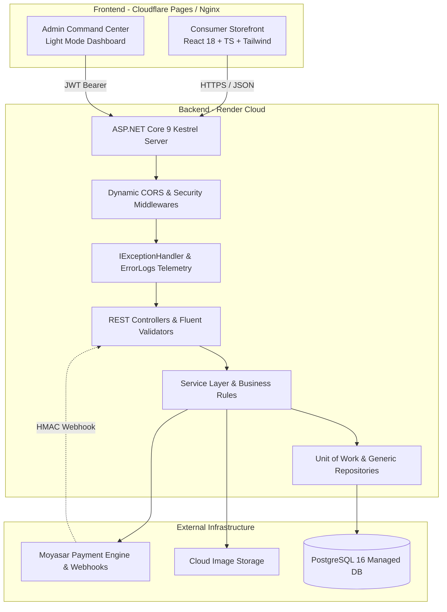
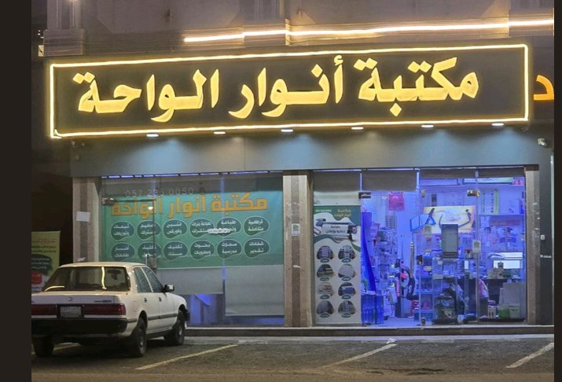

# 📚 Anwar Al-Waha Enterprise E-Commerce & Printing Platform

[](https://anwar-alwaha-store.pages.dev)
[](https://anwar-alwaha-store.onrender.com/healthz)
[](https://dotnet.microsoft.com/)
[](https://react.dev/)
[-336791?style=for-the-badge&logo=postgresql)](https://www.postgresql.org/)
[](https://moyasar.com/)
[](https://www.docker.com/)

> **Production-ready, omnichannel e-commerce ecosystem and digital printing dispatch platform built for *Anwar Al-Waha Library*. Engineered with Clean Architecture, resilient electronic payments, real-time catalog search indexing, server-side error telemetry, and enterprise administrative controls.**

---

## 🌐 Live Deployments & Demos

| Service | Environment | URL |
| :--- | :--- | :--- |
| **Consumer Storefront** | Cloudflare Pages (Production) | [https://anwar-alwaha-store.pages.dev](https://anwar-alwaha-store.pages.dev) |
| **Admin Command Center** | Cloudflare Pages (`/admin`) | [https://anwar-alwaha-store.pages.dev/admin](https://anwar-alwaha-store.pages.dev/admin) |
| **Backend REST API** | Render Cloud (Docker) | [https://anwar-alwaha-store.onrender.com](https://anwar-alwaha-store.onrender.com) |
| **API Health Probe** | Zero-Downtime Monitor | [https://anwar-alwaha-store.onrender.com/healthz](https://anwar-alwaha-store.onrender.com/healthz) |

---

## 📑 Table of Contents
- [Executive Overview](#-executive-overview)
- [System Architecture & Design Patterns](#-system-architecture--design-patterns)
- [Architecture & Engineering Highlights](#-architecture--engineering-highlights)
- [Comprehensive Tech Stack](#-comprehensive-tech-stack)
- [Screenshots & Visual Showcase](#-screenshots--visual-showcase)
- [Project Directory Structure](#-project-directory-structure)
- [Quick Start & Local Deployment](#-quick-start--local-deployment)
  - [Option A: Docker Compose (Recommended)](#option-a-docker-compose-recommended)
  - [Option B: Bare-Metal Development](#option-b-bare-metal-development)
- [Default Admin Credentials & Security](#-default-admin-credentials--security)
- [License & Authorship](#-license--authorship)

---

## 🎯 Executive Overview

**Anwar Al-Waha** is a retail enterprise operating an extensive brick-and-mortar stationery, copy center, and digital printing facility. This project transitions their physical retail footprint into an omnichannel digital platform capable of:
1. **Catalog Scale:** Synchronizing and managing thousands of stationery and educational SKUs imported directly from retail POS systems.
2. **On-Demand Printing Engine:** Providing custom job requests (paper weight, color, binding, thermal printing, roll-up banners) with instant specification calculation.
3. **Consumer Delight:** Fast, mobile-first single page application (SPA) with 100% native Arabic RTL support, phone-verified order tracking, and localized checkout via Saudi payment rails (Mada, Apple Pay, Credit Cards).

---

## 🏛 System Architecture & Design Patterns

The platform adopts a decoupled **Client-Server Architecture** adhering to **Domain-Driven Design (DDD)** and **Clean 3-Layer Architecture** principles.



---

## 🚀 Architecture & Engineering Highlights

### 1. Clean 3-Layer Architecture & Domain Integrity
- **Decoupled Business Logic:** Strict isolation between HTTP transport (`Controllers`), Domain logic (`Services`), and Data access (`Repositories` & `UnitOfWork`).
- **Atomic Operations:** Transactional execution via `IDbContextTransaction` ensuring ACID compliance when creating orders, reducing inventory, and generating payment tokens.

### 2. High-Performance ASP.NET Core 9 Backend
- **Low-Latency Runtime:** Built on .NET 9 with minimal allocations, asynchronous I/O across all controllers, and strongly-typed EF Core 9 configurations.
- **Dynamic Port & Cloud Binding:** Automatically reads `PORT` environment variables provided by PaaS providers (Render) and binds to `0.0.0.0:{PORT}`.
- **Dynamic CORS Policy:** Intelligent origin matcher supporting local development, Cloudflare Pages (`*.pages.dev`), Render, and custom storefront domains.

### 3. Server-Side Error Telemetry & Auto-Purging (`IExceptionHandler`)
- **Centralized Exception Logging:** Implements ASP.NET Core 9's native `IExceptionHandler` using an isolated `IServiceScopeFactory` to persist unhandled 500 server errors even when the current HTTP transaction aborts.
- **StackTrace Safeguard:** Stack traces are normalized and bounded to a maximum of 4,000 characters.
- **Auto-Maintenance:** Database tables automatically purge log records older than 14 days, preventing table bloat without requiring cron jobs.
- **Admin Error Console:** A dedicated administrative UI (`/admin/error-logs`) with status filtering, one-click stack trace copy, and resolution tracking.

### 4. Dynamic Coupon Engine with Admin Visibility Toggle
- **Flexible Promotion Rules:** Supports percentage discounts (with optional maximum ceiling caps) and fixed amount discounts with minimum subtotal requirements.
- **Customer Privacy Toggle:** An admin-controlled setting (`ShowCouponField`) lets store managers show or hide the coupon input box in the checkout and cart pages with zero code changes.
- **Dedicated Management UI:** Admin portal at `/admin/coupons` with instant toggling, usage limit tracking, and expiry dates.

### 5. Resilient Payment Pipeline (Moyasar Gateway & Webhooks)
- **Local Payment Rails:** Direct integration with Moyasar supporting **Mada**, **Apple Pay**, and **Credit Cards**.
- **Idempotent Webhooks:** Tamper-resistant webhook listener that verifies invoice status and confirms orders asynchronously.
- **Non-Blocking Stock Decrements:** Accommodates newly imported cashier items with zero initial stock while maintaining strict inventory integrity for trackable items.

### 6. Seamless Guest Checkout & Saudi Phone Normalizer
- **Zero Friction:** Customers place orders without mandatory passwords or account registration barriers.
- **Saudi Phone Normalization:** Custom algorithm (`SaudiPhoneNormalizer.cs`) standardizing formats (`+9665...`, `009665...`, `9665...`, `05...`) for reliable order lookups and tracking.
- **Verified Buyer Reviews (`/review/:productId`):** High-integrity review system restricted exclusively to verified customers who have previously purchased the SKU.

---

## 💻 Comprehensive Tech Stack

| Tier | Technology / Library | Description |
| :--- | :--- | :--- |
| **Backend** | **ASP.NET Core 9 Web API** | Enterprise C# runtime with Kestrel web server |
| **Database ORM** | **Entity Framework Core 9 / Npgsql** | Strongly-typed object-relational mapping |
| **Database** | **PostgreSQL 16 (Supabase Cloud)** | Managed ACID transactional database |
| **Validation** | **FluentValidation 11** | Declarative DTO validation filters |
| **Security** | **JWT Bearer + BCrypt.Net** | Cryptographic token authentication & salted password hashing |
| **Frontend** | **React 18 + Vite** | Fast modern frontend with component-level HMR |
| **Language** | **TypeScript 5.x** | Strict end-to-end type safety |
| **Styling** | **Tailwind CSS + Lucide Icons** | High-contrast utility classes with first-class Arabic RTL typography |
| **Payments** | **Moyasar API** | Certified Saudi payment gateway integration |
| **DevOps** | **Docker & Docker Compose** | Multi-stage production container builds |

---

## 📸 Screenshots & Visual Showcase

| Storefront & Brand Identity | Mobile-First Catalog Experience |
| :---: | :---: |
|  |  |

*(Additional screenshots of the Admin Command Center, Cart, and Checkout flows can be added inside the [`docs/screenshots/`](docs/screenshots/) directory).*

---

## 📂 Project Directory Structure

```text
anwar-alwaha-store/
├── backend/
│   └── AnwarAlwaha.API/             # ASP.NET Core 9 Web API Project
│       ├── Common/                  # Normalizers, Phone parsers, Options
│       ├── Controllers/             # REST Endpoints (Admin, Orders, Coupons, Reviews)
│       ├── Data/                    # AppDbContext, Entity Configurations, Migrations, Seed
│       ├── DTOs/                    # Data Transfer Objects
│       ├── Entities/                # Domain Entities (Order, Product, Coupon, ErrorLog)
│       ├── Middlewares/             # Global Exception Handler, Security Headers
│       ├── Repositories/            # Generic Repository & Unit of Work implementations
│       ├── Services/                # Business logic (Moyasar, Orders, POS, Barcodes)
│       ├── Validators/              # FluentValidation schemas
│       ├── appsettings.json         # Production configuration
│       └── Dockerfile               # Multi-stage .NET 9 container build
│
├── frontend/
│   └── anwar-alwaha-web/            # React 18 + TypeScript + Vite SPA
│       ├── public/                  # Favicons, logo SVG, _redirects
│       ├── src/
│       │   ├── admin/               # Admin pages (Dashboard, Coupons, ErrorLogs, Products)
│       │   ├── api/                 # Typed Axios clients (ordersApi, couponsApi, etc.)
│       │   ├── components/          # Reusable UI widgets (Cart, Modal, StarRating)
│       │   ├── context/             # React Context (Auth, Cart, Customer, Toast)
│       │   ├── pages/               # Consumer pages (Home, Cart, Checkout, Review)
│       │   ├── types/               # Domain interfaces & API response contracts
│       │   ├── App.tsx              # Application routing & route guards
│       │   └── main.tsx             # Entry point
│       ├── Dockerfile               # Nginx Alpine production build
│       └── vite.config.ts           # Vite configuration & proxy
│
├── docs/                            # Documentation, runbooks, and screenshots
│   ├── screenshots/                 # Showcase and UI preview images
│   └── DEPLOYMENT_GUIDE.md          # Production deployment guide
│
├── docker-compose.yml               # Unified multi-container orchestration
├── .gitignore                       # Clean Git ignore rules
└── README.md                        # Master architectural documentation
```

---

## ⚡ Quick Start & Local Deployment

### Prerequisites
- [.NET 9.0 SDK](https://dotnet.microsoft.com/download/dotnet/9.0)
- [Node.js 20+ LTS](https://nodejs.org/)
- [PostgreSQL 16+](https://www.postgresql.org/) (or Docker Desktop)

---

### Option A: Docker Compose (Recommended)

Spin up the complete ecosystem (PostgreSQL 16 + ASP.NET Core API + React SPA on Nginx) with one command:

```bash
docker compose up --build -d
```

- **Consumer Web App:** `http://localhost` or `http://localhost:5173`
- **Admin Dashboard:** `http://localhost/admin`
- **Backend API Docs (Swagger):** `http://localhost:5000/swagger`
- **Backend Health Check:** `http://localhost:5000/healthz`

---

### Option B: Bare-Metal Development

#### 1. Backend (.NET 9 API)
```bash
cd backend/AnwarAlwaha.API

# Run migrations and launch Kestrel
dotnet run
```
*API will listen on `http://localhost:5000` with Swagger available at `/swagger`.*

#### 2. Frontend (React 18 + Vite)
```bash
cd frontend/anwar-alwaha-web

# Install dependencies
npm install

# Start development server
npm run dev
```
*Frontend opens at `http://localhost:5173`.*

---

## 🔐 Default Admin Credentials & Security

The platform automatically seeds an administrator account upon initial database setup:

- **Admin Login Route:** `/admin/login`
- **Default Email:** `admin@anwaralwaha.com`
- **Default Password:** `Admin@123456!`
*(Credentials can be securely overridden in production via the `ADMIN_INITIAL_EMAIL` and `ADMIN_INITIAL_PASSWORD` environment variables).*

---

## 📄 License & Authorship

Developed and engineered by **Aymn Ahmed** for **Anwar Al-Waha Library**.  
All rights reserved © 2026.
